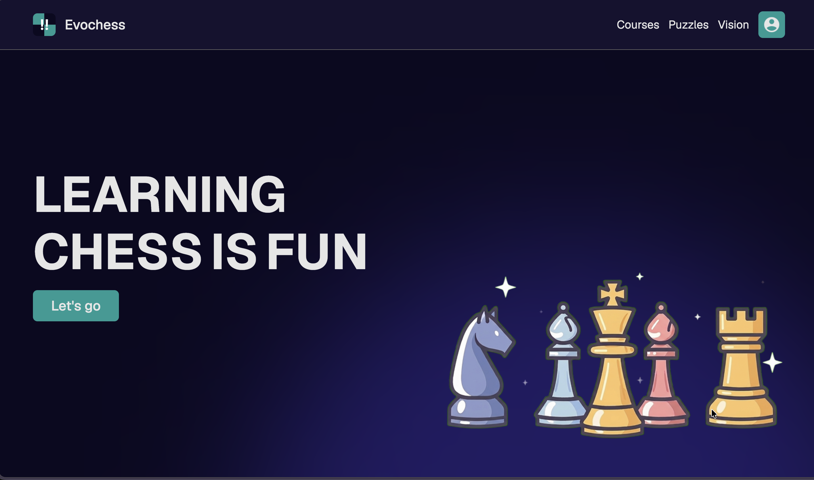

# Evochess

A website where you can learn and improve your chess skills.

Try it -> [evochess.vercel.app](evochess.vercel.app)

## ‼️ Important ‼️

The home page is scrollable. There are 4 sections in home page. I didn't want you to miss that 😃

## Home page

- Consists hero, courses, puzzles and visualization section.
- Each section tells you the purpose of the website with subtle and fun animations

## Courses page

- Provides a structured learning path.
- Progress bar to keep track of how many courses you've completed.
- Info about what you'll learn are mentioned in brief bullet points
- Courses are divided into three levels (Beginner, Intermediate and Advanced).
- Earn badge after completing a level of course. (They are displayed at the bottom of container containing progress bar)

## Puzzles page

- Contains working chessboard and a sidebar
- 30 puzzles are included
- Ability to move piece by both clicking and dragging
- Ability to move back and forth between the completed levels.

## Vision page

- Contains chessboard and a sidebar
- Displays the square that needs to be clicked
- Displays current and best score
- Options for toggling coordinates, choosing time and choosing color
- According to the time and color, multiple best scores are stored
- Contains countdown timer and score counter

## Signup / Login page

- Secure signup and login using jwt (json web token)
- Hashed password
- Option to login as guest

## Responsive design

I've tried my best to make the website responsive using css clamp, media queries, flexbox and grids.

## A small note for reviewers

You can find comments here and there in my code and they're written by me. So, please don't say the code is ai generated on that basis. Also all the devlogs were also written by me. I have clearly declared my ai usage on stardance.

## Credits

### Responsive design

- Clamp calculator: [https://www.marcbacon.com/tools/clamp-calculator/](https://www.marcbacon.com/tools/clamp-calculator/)

### Chess websites I took inspiration from

- [chess.com](https://chess.com)
- [lichess.org](https://lichess.org)
- [wintrchess.com](https://wintrchess.com/analysis)
- [chesskid.com](https://www.chesskid.com/)
- [https://www.canva.com/design-school/courses/](https://www.canva.com/design-school/courses/)

### Video inspirations

- [https://youtu.be/YJ3QuPUeqmU?si=147BVPyXCwWN8pxd](https://youtu.be/YJ3QuPUeqmU?si=147BVPyXCwWN8pxd)
- [https://youtu.be/f3lp4lITGNg?si=jAsewYmx0uyKv4](https://youtu.be/f3lp4lITGNg?si=jAsewYmx0uyKv4)

### All youtube channels whose video I used

- Chess.com
- Kamryn
- Chess Talk
- NM Robert Ramirez
- GothamChess
- BotezLive
- Chess Thugs
- RiseAboveRealitydl
